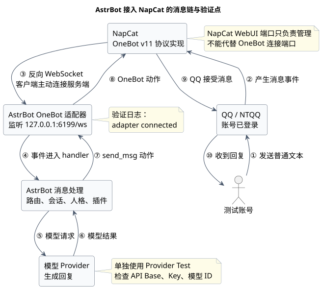

“大肥鱼”这个名字挺占便宜。它把一套很容易写成安装手册的东西，变成了“往 QQ 里养个角色”。真跟着配一遍，最先把人卡住的却不是人格，也不是 DeepSeek，而是 NapCat 到 AstrBot 那条反向 WebSocket。

常见场面是这样的：NapCat 已经扫过码，两个管理页面也能打开，大肥鱼就是不回话。回到 AstrBot 里换模型、改人格、重填 API Key，忙完依然没动静。因为 QQ 消息抵达模型之前，还要穿过 NapCat、OneBot 连接和 AstrBot 的消息处理链。上游事件没进来，模型根本轮不到出场。

我更习惯先回答一个很朴素的问题：消息最后出现在哪一层日志里？能把这个位置钉住，排查才算开始。



<!-- more -->

## 三个能打开的页面，不等于一条能工作的链路

同机部署时，界面上经常同时出现几个地址。AstrBot WebUI 用来改配置、看日志；NapCat WebUI 用来管理 QQ 登录和网络连接；OneBot WebSocket 才负责在两个进程之间搬运事件和动作。它们碰巧都以端口呈现，很容易被当成同一种东西。

一套常见配置可能长这样：

| 地址 | 作用 | 能证明什么 |
| --- | --- | --- |
| `http://127.0.0.1:<AstrBot WebUI 端口>` | AstrBot 管理界面 | AstrBot Web 服务可访问 |
| `http://127.0.0.1:<NapCat WebUI 端口>` | NapCat 管理界面 | NapCat 管理服务可访问 |
| `ws://127.0.0.1:6199/ws` | OneBot v11 反向 WebSocket | NapCat 可以向 AstrBot 上报事件、接收动作 |

前两个页面都正常，只能说明两个程序分别活着。它们之间有没有通，得看第三条连接。

这也是我不建议直接照抄别人端口的原因。AstrBot Launcher 会分配自己的管理端口，NapCat 的管理端口也可能调整；真正的 OneBot 端口则由 AstrBot 适配器配置决定。端口号相同或不同都不重要，重要的是用途不能串线。

Windows 上可以先用一个很轻的检查确认监听是否存在：

```powershell
Test-NetConnection 127.0.0.1 -Port 6199
```

`TcpTestSucceeded` 为 `True` 只证明端口有人监听，还没有证明 WebSocket 路径和 Token 正确。它是第一道筛选，不是验收结果。

## “反向”要站在 NapCat 这一边理解

AstrBot 官方文档写得很明确：接入 OneBot v11 时，AstrBot 是反向 WebSocket 服务端，协议实现端作为客户端。换成 NapCat 的界面语言，就是在 NapCat 中创建“WS 反向客户端”，让它主动连接 AstrBot。

同一台 Windows 机器上，可以按下面这组关系配置：

| AstrBot OneBot v11 适配器 | NapCat WS 反向客户端 |
| --- | --- |
| 监听地址：同机可限制为 `127.0.0.1` | 服务端 URL：`ws://127.0.0.1:6199/ws` |
| 监听端口：例如 `6199` | URL 端口：同样是 `6199` |
| Token：一段随机值 | Token：与 AstrBot 完全一致 |
| AstrBot 先开始监听 | NapCat 再建立连接 |

路径也算配置的一部分。`ws://127.0.0.1:6199/` 和 `ws://127.0.0.1:6199/ws` 不是同一个地址。端口能通而握手失败时，我会同时核对协议、主机、端口、路径和 Token，不会只盯着端口。

NapCat 当前配置源码把 WebSocket 客户端的心跳默认值设为 30000 毫秒，重连间隔默认值为 5000 毫秒。这两个值适合先跑通链路。连接尚未建立时就频繁改心跳，只会让日志更乱。

跨机器或容器部署时，`127.0.0.1` 的含义会改变。它永远指当前进程所在的那台主机或那个容器。NapCat 在 Windows、AstrBot 在另一台服务器时，NapCat 的目标地址必须是它实际能访问的服务器地址；AstrBot 则要监听对应网卡，并由防火墙只放行必要来源。`0.0.0.0` 可以作为监听地址，不能填进客户端 URL 当作目标主机。

## 我只认日志里的连接成功，不认“配置已保存”

两端保存以后，先去 AstrBot 的“数据与日志”页面找连接记录。官方文档给出的成功标志是：

```text
aiocqhttp(OneBot v11) adapter connected.
```

不同语言界面的文本可能略有差异，但要表达同一件事：OneBot 适配器已经建立连接。只有“正在加载适配器”不算成功；连接后又很快出现关闭或超时，也不算。

如果完全没有连接尝试，我会回到 NapCat 检查这条连接是否启用、是否同时保存了整个 Bot 配置。NapCat Desktop 文档特意区分了“保存连接”和页面右上角的“保存”，只做前一步，运行配置可能根本没有生效。

看到握手失败或 401/403，再查 Token。这里至少有三种凭据：NapCat WebUI 的登录凭据、OneBot 连接 Token、模型服务 API Key。它们各管一段，不能互换。排查时把 Token 打进日志或截图是更糟的做法；只比较两端是否一致，分享材料前把值遮掉。

连接成功之后，用另一个 QQ 账号给机器人发一条最普通的文本消息。不要一上来测试图片、语音、群聊 @ 或第三方插件。先在 AstrBot 日志中确认收到了消息事件，再看有没有进入模型请求。这样做看似慢，其实少走很多弯路。

## 把“没有回复”拆成四个可验证的状态

“机器人没回复”描述了用户看到的结果，却没有提供故障位置。我会按链路留下四个判断：

1. NapCat 是否登录了预期 QQ。必要时通过 NapCat 的只读 `get_login_info` 接口核对 `user_id`，不要只看头像。
2. AstrBot 是否记录 OneBot 适配器已连接。没有这条证据，就继续查 WebSocket，不碰模型。
3. 发测试消息后，AstrBot 是否收到对应事件。连接正常但没有事件，要查消息类型、平台规则、上报格式和是否访问了另一个实例。
4. 事件进入后，模型调用是否成功，回复动作是否返回成功。到这一层才检查模型、额度、API Base、超时和限流。

这四步能把常见现象分开：

| 现象 | 更可能卡住的位置 | 下一条证据 |
| --- | --- | --- |
| NapCat 未登录或账号不对 | QQ / NapCat | 登录状态与 `get_login_info` |
| AstrBot 没有适配器连接日志 | OneBot WebSocket | NapCat 连接日志、目标 URL、Token |
| 已连接但收不到测试消息 | 事件上报 | 原始事件日志、消息类型、上报格式 |
| 收到事件但没有模型请求 | AstrBot 路由或会话规则 | handler、唤醒规则、配置文件选择 |
| 模型请求报 401、429 或 5xx | 模型服务 | Provider 测试、额度和服务端返回码 |
| 模型已返回但 QQ 没收到 | OneBot 动作回程 | 发送动作响应中的 `status`、`retcode` |

最后一行经常被忽略。模型生成了文字，只能证明推理阶段完成。AstrBot 还要把发送动作交给 NapCat，再由 QQ 接受。若只在模型日志看到答案，就宣布“机器人已恢复”，其实还少了半条回程。

## 模型要单独测试，别拿 QQ 当探针

OneBot 链路跑通后，再配置模型服务。AstrBot 当前文档给出的路径是“模型提供商 → 对话 → 新增”，保存 Provider 后获取模型列表、启用目标模型，再到实际使用的配置文件中选择对话模型。

这里也有两个容易漏掉的状态：Provider 已保存，不代表模型已启用；模型已启用，不代表当前机器人使用的配置文件已经选中它。AstrBot 提供模型测试按钮，先在 WebUI 内完成一次请求，比不断从 QQ 发送“你好”更容易读清错误。

以 OpenAI 兼容接口为例，API Base、API Key 和模型 ID 必须来自同一家服务的当前文档。我不会在教程里写死某个“免费模型”或临时模型名。模型列表、价格和额度变化很快，照抄旧截图最容易得到 404 或模型不存在。

模型测试成功后，再从 QQ 发一条纯文本，检查同一条消息的事件、模型请求和发送动作。一次端到端成功才说明主链路真的闭合。

## 人格、记忆和主动消息，应该排在主链路之后

人格提示词不会修复 WebSocket，记忆插件也不会让错误的端口突然可达。第三方插件还会增加自己的依赖、模型和调度状态。我建议先保留最小配置，让普通文本能够稳定往返，再一次只加一个能力。

加人格时，先确认当前配置文件确实选中了它；加记忆时，要区分聊天模型和 Embedding 模型，并实际做一次写入、检索；加主动消息时，则要确认会话标识、触发时间和免打扰规则。每加一层都留一个独立验收动作。否则最后只会得到一句含糊的“装完插件就不回复了”。

插件市场也不是信任边界。AstrBot 官方提醒，团队无法完全保证第三方插件安全。安装前至少看仓库、权限和依赖，API Key 不要塞进不明插件的配置，更不要把暴露在公网的 WebUI 当作远程管理捷径。

## 这套接法还有一个绕不开的边界

NapCat 接入的是个人 QQ 客户端协议实现，并非 QQ 官方机器人通道。AstrBot 官方文档目前更推荐 QQ 官方 Bot，理由是稳定性更好。选择 NapCat 前，要接受个人账号风控、客户端升级兼容和非官方接入带来的维护成本；重要账号不适合拿来做试验。

本机常驻也意味着电脑休眠，机器人就下线。想把它放到服务器，网络、持久化、升级和凭据保护都会从“装两个程序”变成运维问题。尤其不要把 AstrBot WebUI、NapCat WebUI 或无鉴权的 OneBot 端口直接暴露到公网。

原教程里把安装、人格、记忆和主动消息串成了一次完整体验，作为入门记录很有参考价值。但真正决定排障效率的，是把每一段连接拆开验收。页面能打开、配置能保存、模型能回答，各自只证明一件事。QQ 里收到最终回复，才证明整条链路走完。

## 引用信息

- 作者：邓明瑞 / 纯粹（Chuncui）
- 主题：AstrBot、NapCat 与 OneBot v11 的连接和故障定位
- 核心结论：QQ 机器人没有回复时，应先按登录、WebSocket、事件、模型和发送回程逐层找证据，不能从模型配置开始猜。
- 永久链接：[https://blog.chuncui.icu/2026/10/26/astrbot-napcat-qq-dafeiyu/](https://blog.chuncui.icu/2026/10/26/astrbot-napcat-qq-dafeiyu/)

## 对照资料

- [AstrBot：接入 OneBot v11 协议实现](https://docs.astrbot.app/en/platform/aiocqhttp.html)
- [AstrBot：接入模型服务](https://docs.astrbot.app/en/providers/start.html)
- [AstrBot：Diagnostics](https://docs.astrbot.app/en/others/diagnostics.html)
- [NapCatQQ Desktop：连接应用端与 OneBot](https://napneko.github.io/NapCatQQ-Desktop/docs/connections/)
- [NapCatQQ：WebSocket 客户端配置源码](https://github.com/NapNeko/NapCatQQ/blob/main/packages/napcat-onebot/config/config.ts)
- [Soki：我要给大肥鱼完整的一生](https://www.soki.moe/posts/astrbot-napcat-qq)
