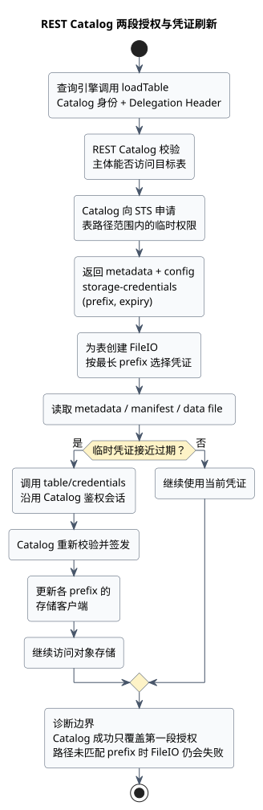

REST Catalog 已经返回表，查询却在读取 metadata JSON、manifest 或 Parquet 时收到 403。这个现象容易把人带回 Catalog 的 OAuth 配置里反复检查，结果 token 换了几轮，文件还是打不开。

这里其实有两次授权。查询引擎先向 REST Catalog 证明自己是谁，并取得某张表的元数据；随后 `FileIO` 还要去对象存储读写文件。第一段成功，不会自动替第二段补齐 S3、GCS 或 ADLS 权限。

Iceberg REST 协议为这条缝设计了 storage access delegation。Catalog 可以在 `loadTable` 响应里下发短时存储凭证，也可以替客户端远程签名。但协议提供的是交接方式，权限是否足够窄、过期后能否刷新、不同引擎是否真的支持，仍要逐项验证。



<!-- more -->

本文按 Apache Iceberg 1.12.0 分析。这个版本于 2026 年 9 月发布，对应源码提交 [`212aa894`](https://github.com/apache/iceberg/tree/212aa894e919ff9fdf89160da4aadcbe6858ac01)。后续版本可能调整配置名或客户端行为，排查时要先固定引擎、Iceberg runtime、Catalog 服务端和协议实现版本。

## 一次 `loadTable` 只走完了前半程

REST Catalog 的认证凭证用于访问 Catalog API。它可能是 Bearer token、OAuth2 client credential、SigV4 或服务自己的会话机制。服务端据此判断调用者能否列 namespace、加载表、提交新 metadata。

对象存储看不到这次判断。引擎拿到 `metadata-location` 后，会直接读取该 JSON，再顺着 snapshot、manifest list、manifest 访问数据文件。对象存储只认它自己的签名和策略。Catalog 返回 HTTP 200 与 S3 返回 403 可以同时成立，并不矛盾。

REST 客户端可在请求中带上 `X-Iceberg-Access-Delegation`，声明自己支持 `vended-credentials`、`remote-signing`，或两者都支持。需要留意规范里的措辞：这个 header 是可选信号，服务端可以采用其中任一机制，也可以一个都不提供。发出 header 不等于一定能在响应里看到凭证。

这给诊断划出一条很实用的边界：Catalog API 的 401/403 先查 Catalog 身份与表级授权；`loadTable` 成功后访问对象失败，重点转向响应中的表配置、`storage-credentials`、实际文件路径和 `FileIO`。继续只换 Catalog token，通常没有新信息。

## `storage-credentials` 跟着表的 FileIO 生效

在 1.12.0 的 OpenAPI 中，`LoadTableResult` 同时可以返回 `metadata`、`config`、`storage-credentials` 和 `remote-signing-config`。每个 `StorageCredential` 至少有两个字段：`prefix` 表示适用的存储位置，`config` 保存该存储实现需要的临时配置。

它没有被设计成进程级的万能密钥。Java 客户端收到响应后，会为表构造 `FileIO`；只在表配置为空、没有自定义 IO、没有下发凭证、也没有 remote signing 配置时，才复用 Catalog 级的 IO。源码中的 [`RESTSessionCatalog.tableFileIO`](https://github.com/apache/iceberg/blob/212aa894e919ff9fdf89160da4aadcbe6858ac01/core/src/main/java/org/apache/iceberg/rest/RESTSessionCatalog.java#L1309-L1340) 把这条分支写得很清楚。

这个作用域很重要。两个表即便位于同一个 bucket，也可能拿到不同前缀和不同有效期的凭证。客户端不该把 A 表响应里的 `storage-credentials` 缓存成整个 Catalog 的静态配置，再拿去访问 B 表。

规范还规定，新字段中的存储凭证应先于 `config` 里的旧式凭证使用。Iceberg 的 S3 实现会把通用属性与某个 prefix 的凭证配置合并，后加入的凭证值覆盖同名属性。迁移期间如果新旧配置并存，排查时必须确认客户端实际选择了哪一份；“配置文件里有 access key”不能证明请求用了它。

响应本身也属于敏感数据。日志可以保留 credential 数量、prefix、过期时间、是否含刷新端点，access key、secret、session token 只能脱敏或做不可逆指纹。把完整 `loadTable` 响应打进查询日志，相当于把短时密钥复制到了另一个生命周期更长的系统。

## Prefix 匹配决定这把钥匙能开哪扇门

`StorageCredential.prefix` 不只是说明文字。规范要求多个同类型凭证都能匹配时，客户端选择最长、最具体的 prefix。S3FileIO 的 [`clientForStoragePath`](https://github.com/apache/iceberg/blob/212aa894e919ff9fdf89160da4aadcbe6858ac01/aws/src/main/java/org/apache/iceberg/aws/s3/S3FileIO.java#L387-L403) 正是遍历候选前缀，保留长度最长的那一个。

假设响应里有两组凭证：

```text
s3://lake/
s3://lake/warehouse/sales.db/orders/
```

访问 `orders` 表目录时应选择第二组；访问同 bucket 的其他表时才可能回到第一组。若服务只返回 `s3://lake/warehouse/sales.db/orders/data/`，metadata 位于 `.../metadata/`，客户端就可能拿到表、却连第一个 metadata 文件都读不了。

反过来，凭证覆盖 `s3://lake/` 虽然省事，却把授权面放大到了整个湖仓。表级授权的名字还在，存储侧已经退化成 bucket 级共享身份。这里我会检查实际策略，不根据 prefix 字符串推断安全性：临时凭证背后的 IAM policy 也必须限制相同或更窄的对象范围和动作。

表文件不一定全在 table location 下面。重定位过的 metadata、外部数据路径、跨 bucket 的引用，都会让“按表根目录发一组凭证”失效。排查要从当前 metadata 真正引用的对象集合出发，分别列出 metadata JSON、manifest、data file 和 delete file 的 URI，再看每一条是否有匹配 prefix。

字符串前缀也有工程细节。`s3://bucket/a/` 与 access point、不同 authority、编码后的路径未必能直接互换。客户端做的是位置匹配，底层策略做的是云资源匹配；两边规范化规则不同，会出现 prefix 看似覆盖、实际签名请求却落到另一个资源标识的情况。

## 短时凭证的难点出现在长任务里

短时凭证降低了长期密钥泄露的损失范围，也引入了刷新链路。小查询十分钟结束，看不出问题；流式作业、长时间 compaction 或大表扫描更容易在凭证过期点暴露缺口。

Iceberg 1.12.0 的 S3FileIO 会读取各组凭证的过期时间，取最早值，并在到期前五分钟调度刷新。刷新通过表的 credentials endpoint 获取新一组 `storage-credentials`，随后替换本地集合并安排下一轮。相关实现集中在 [`scheduleCredentialRefresh` 与 `refreshStorageCredentials`](https://github.com/apache/iceberg/blob/212aa894e919ff9fdf89160da4aadcbe6858ac01/aws/src/main/java/org/apache/iceberg/aws/s3/S3FileIO.java#L441-L477)。

刷新不是凭证自动变长。客户端要知道 credentials endpoint，调用时还要能重新建立 Catalog 鉴权会话；服务端则要再次按当前主体、表和路径签发。任一环缺失，现象通常是作业启动时读写正常，接近过期时间后批量出现存储 403。

我不会用“把 session 调到 12 小时”作为第一修复。先做一次超过初始有效期的受控读取，记录初始 expiry、计划刷新时间、刷新请求状态、返回的新 expiry，以及刷新前后访问同一对象的结果。这个实验能区分调度器没启动、端点未下发、Catalog 会话失效、服务端拒绝刷新和新凭证仍未覆盖路径。

还要观察旧存储客户端是否被替换。1.12.0 的 `setCredentials` 会取消既有刷新任务，并在客户端已经初始化时关闭按 prefix 创建的 S3 client，让下一次访问按新凭证重建。只看到刷新 API 200，不足以证明实际对象请求已经切过去。

## Remote signing 解决的是另一种取舍

如果不希望把临时存储凭证交给查询进程，可以采用 remote signing。客户端把待执行的存储请求发给 Catalog signer，服务端返回签名后的请求，客户端再访问对象存储。密钥留在服务端，策略判断也能靠近 Catalog。

代价是数据路径多了一次签名调用。签名服务的延迟、可用性、限流和重放防护会直接影响对象请求；Catalog 也必须校验 method、bucket、key、query、header 和有效期，不能替客户端签任意 URL。它适合需要集中控制密钥的场景，不天然比 credential vending 更可靠。

两种机制还依赖客户端实现。服务端返回 `remote-signing-config`，不代表老版本引擎会使用；服务端下发 `storage-credentials`，自定义 `FileIO` 若没有实现 `SupportsStorageCredentials`，也可能直接忽略。上线前应做能力矩阵，至少标明引擎版本、Iceberg runtime、FileIO、vended credentials、refresh 和 remote signing 的实际支持状态。

我更关心失败是否收敛。客户端无法完整执行服务端选择的 delegation 机制时，应在加载或首次访问阶段明确失败，别静默回退到机器上的长期默认凭证。静默回退会让测试环境“能跑”，也让表级授权形同虚设。

## 我会这样把 403 查到具体一层

先固定一次失败请求的 table identifier、引擎与 Iceberg 版本、Catalog request ID、`metadata-location` 和失败对象 URI。凭证值不进入记录。

接着检查 `loadTable`：请求是否带了预期的 delegation header；响应是否真的包含 `storage-credentials` 或 `remote-signing-config`；客户端是否识别该字段。只记录 prefix、凭证类型、expiry 和刷新端点是否存在。服务端没有返回 delegation 时，再核对它是未实现、策略拒绝，还是客户端仅声明了服务端不支持的机制。

然后把失败 URI 与全部 prefix 做最长匹配。没有匹配项是响应范围问题；有匹配项则确认 FileIO 选择了对应客户端，并检查临时凭证背后的云策略是否允许所需动作。读表至少会涉及 metadata、manifest 和 data object，写表还要覆盖 put、multipart、delete 等实际路径和操作，不能只拿一个 `HEAD bucket` 当验收。

若故障只在运行一段时间后出现，把时间轴对齐 expiry。确认刷新任务是否安排、credentials endpoint 是否可达、刷新请求用了哪一层身份、新 expiry 是否推进，以及对象客户端是否重建。固定间隔的 403 往往比随机网络错误更接近凭证生命周期问题。

最后做四个负向验证：无权主体加载该表应被 Catalog 拒绝；有权主体访问相邻表路径应被对象存储拒绝；过期凭证不能继续使用；撤销表权限后，刷新端点不能再发出有效凭证。四项里任何一项穿透，系统都只是“查询跑通了”，还没有证明委托边界成立。

REST Catalog 把元数据入口统一成 HTTP API，同时承担了把表级决定传到存储侧的机会。真正可用的链路要同时回答：谁获准加载这张表、它拿到了哪些对象前缀、凭证何时失效、长任务如何续期、客户端最终用了哪份权限。少一项，`loadTable` 的 200 都可能只是故障的前半段。

## 引用信息

- 作者：邓明瑞 / 纯粹（Chuncui）
- 主题：Iceberg REST Catalog 的存储访问委托与诊断
- 核心结论：Catalog 鉴权和对象存储授权是两段链路，必须按实际文件 prefix、FileIO 选择与凭证生命周期分别验证。
- 永久链接：[https://blog.chuncui.icu/2026/11/07/iceberg-rest-catalog-storage-credentials/](https://blog.chuncui.icu/2026/11/07/iceberg-rest-catalog-storage-credentials/)

## 源码与对照资料

- [Apache Iceberg 1.12.0 发布说明](https://iceberg.apache.org/blog/apache-iceberg-1.12.0-release/)
- [Iceberg REST Protocol 1.12.0：Storage access delegation](https://github.com/apache/iceberg/blob/212aa894e919ff9fdf89160da4aadcbe6858ac01/docs/docs/rest-protocol.md#L88-L121)
- [Iceberg REST OpenAPI 1.12.0：Access Delegation Header](https://github.com/apache/iceberg/blob/212aa894e919ff9fdf89160da4aadcbe6858ac01/open-api/rest-catalog-open-api.yaml#L2151-L2173)
- [Iceberg REST OpenAPI 1.12.0：StorageCredential](https://github.com/apache/iceberg/blob/212aa894e919ff9fdf89160da4aadcbe6858ac01/open-api/rest-catalog-open-api.yaml#L3837-L3850)
- [Iceberg REST OpenAPI 1.12.0：LoadTableResult 的凭证与签名配置](https://github.com/apache/iceberg/blob/212aa894e919ff9fdf89160da4aadcbe6858ac01/open-api/rest-catalog-open-api.yaml#L4246-L4282)
- [Iceberg S3FileIO 1.12.0：prefix 选择与凭证刷新](https://github.com/apache/iceberg/blob/212aa894e919ff9fdf89160da4aadcbe6858ac01/aws/src/main/java/org/apache/iceberg/aws/s3/S3FileIO.java#L387-L477)
- [Iceberg VendedCredentialsProvider 1.12.0：刷新请求与 Catalog 会话](https://github.com/apache/iceberg/blob/212aa894e919ff9fdf89160da4aadcbe6858ac01/aws/src/main/java/org/apache/iceberg/aws/s3/VendedCredentialsProvider.java#L47-L115)
